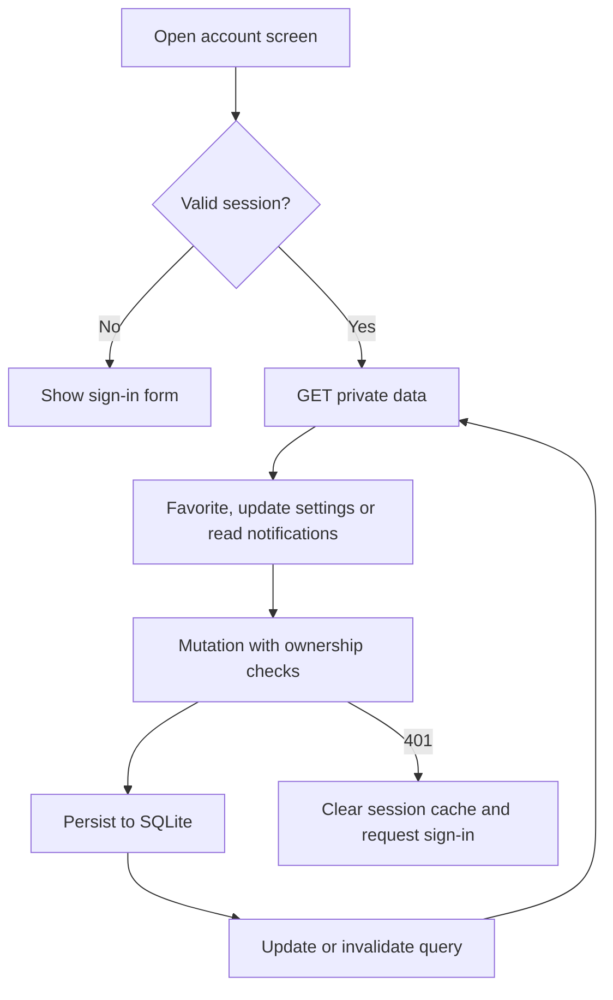

# Favorites, settings and notifications

Private account screens require a session and store user-scoped data in SQLite.

Routes: `/account/favorites`, `/account/settings`, `/account/notifications`.
API: `/api/v1/me/favorites`, `/me/settings`, `/me/notifications`, and their mutation endpoints.
Favorites are unique by user/kind/id; repeated additions do not create duplicates.
Settings PATCH merges only supplied fields. Read-all stops at the request's captured boundary,
preserving notifications arriving afterward as unread.
Backend events create deduplicated notifications and respect notification preferences.
Notifications are in-app only; no push service or background poller monitors every match.
Sign-in, sign-out and account switching clear private query caches.

Related files:

- [frontend/src/features/favorites](../frontend/src/features/favorites)
- [frontend/src/features/settings](../frontend/src/features/settings)
- [frontend/src/features/notifications](../frontend/src/features/notifications)
- [backend/src/modules/me](../backend/src/modules/me)
