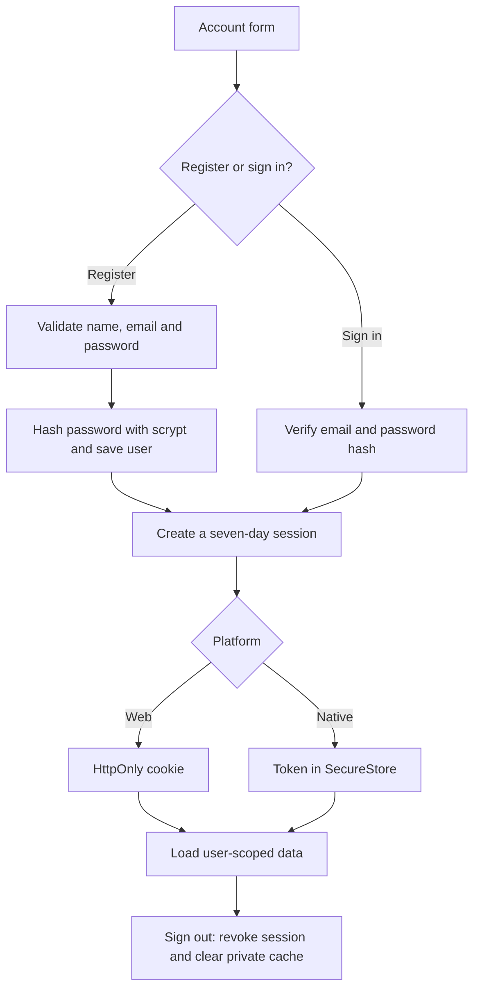

# Registration and sign-in

Open Settings to register or sign in with email and password. App identity is independent of the selected Dota account.

API: `POST /api/v1/auth/register`, `/auth/login`, `/auth/logout`; `GET /api/v1/auth/session`.
Passwords accept 6–128 characters without trimming; names accept 2–80 characters.
Email addresses are normalized before storage. Validation errors return 400, invalid credentials 401,
duplicate emails 409, and excessive attempts 429.

Web requests validate Origin. Do not mix cookies and Bearer tokens. SQLite stores password and session token hashes.
Legacy users with an active session can set credentials through `POST /api/v1/auth/credentials`, retaining their user ID.
Migration 003 preserves dependent data; keep existing migrations unchanged.
Password reset/change and email verification are not implemented. Steam authentication has been removed.

Related files:

- [frontend/src/features/auth/AccountGate.tsx](../frontend/src/features/auth/AccountGate.tsx)
- [frontend/src/features/auth/SessionProvider.tsx](../frontend/src/features/auth/SessionProvider.tsx)
- [backend/src/modules/auth/index.ts](../backend/src/modules/auth/index.ts)
- [backend/src/modules/auth/password.ts](../backend/src/modules/auth/password.ts)
