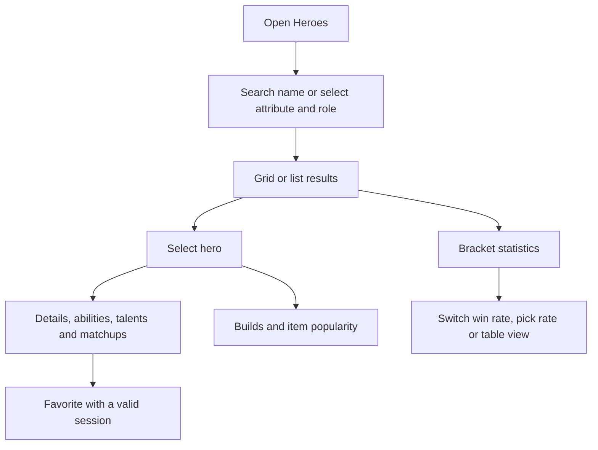

# Heroes, statistics and builds

Browse heroes in grid or list view, filter results, then open details, bracket statistics or builds.

Routes: `/main/heroes`, `/heroes/detail`, `/heroes/ranks`, `/heroes/build`.
Backend routes use `/api/v1/heroes` and its child endpoints; the frontend receives normalized DTOs.
Pick rate remains null when the source denominator is unavailable. Builds represent source item popularity,
not recommended-build win rates. Hero rankings depend on a feature flag and return 501 when disabled.

Related files:

- [frontend/src/features/heroes](../frontend/src/features/heroes)
- [frontend/src/features/builds](../frontend/src/features/builds)
- [backend/src/modules/heroes](../backend/src/modules/heroes)
