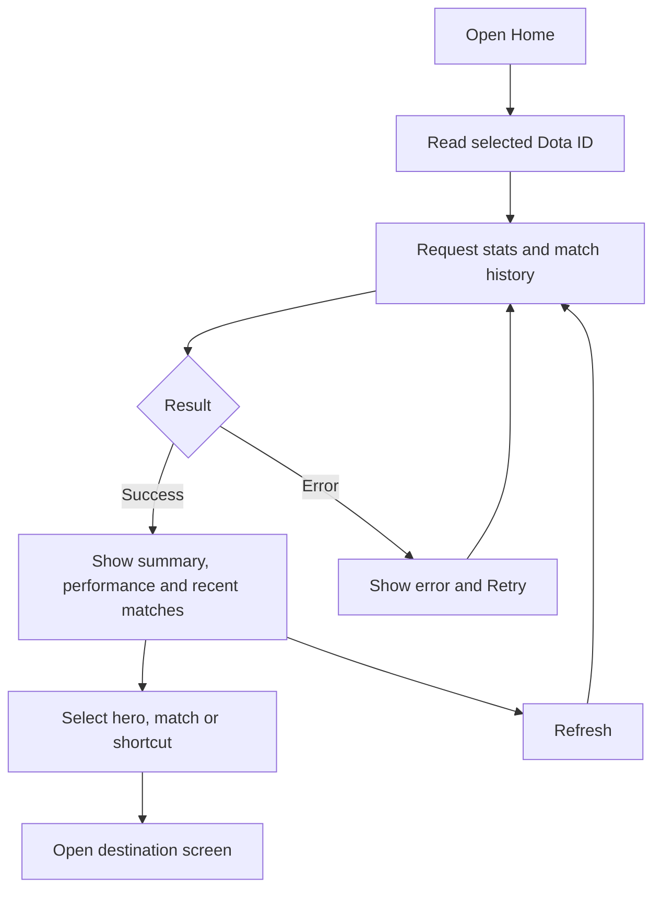

# Home and refresh

Home combines public data for the selected Dota account with shortcuts to other features.

Route: `/main`. Recent performance uses up to 20 matches; unavailable values remain null.
Refresh reloads related query groups. API failures do not fall back to sample data.
Notifications and Search open from the header and have separate flows.

Related files:

- [frontend/src/features/home/screens/HomeScreen.tsx](../frontend/src/features/home/screens/HomeScreen.tsx)
- [frontend/src/shared/navigation/routes.ts](../frontend/src/shared/navigation/routes.ts)
- [backend/src/modules/players/service.ts](../backend/src/modules/players/service.ts)
