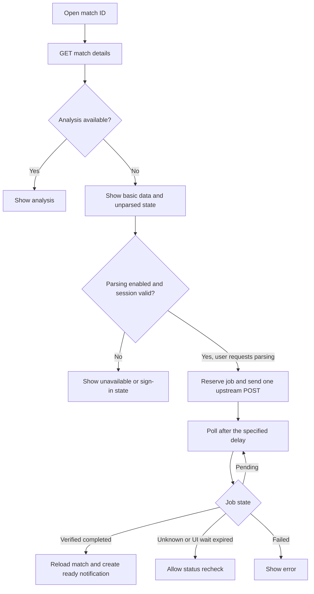

# Match details and parsing

Look up a match ID or select a history entry. Unparsed matches still show basic information.

API: `GET /api/v1/matches/:id`, `POST /api/v1/matches/:id/parse`, and `GET /api/v1/parse-jobs/:id`.
Route: `/matches/detail`. Parsing is disabled by default; enable `ENABLE_MATCH_PARSE=true` with account features.
Only one active job is reserved per match; access is granted per user.
Do not automatically retry POST after timeout or an uncertain acknowledgement.
Completion requires a fresh match response with a parsed version, not merely a missing queue entry.
Poll no faster than every five seconds. The UI stops active waiting after two minutes without marking the job failed.
Live parse POST has not been verified; automated fixture tests cover the workflow.

Related files:

- [frontend/src/features/matches](../frontend/src/features/matches)
- [backend/src/modules/matches](../backend/src/modules/matches)
- [backend/src/modules/parse-jobs](../backend/src/modules/parse-jobs)
