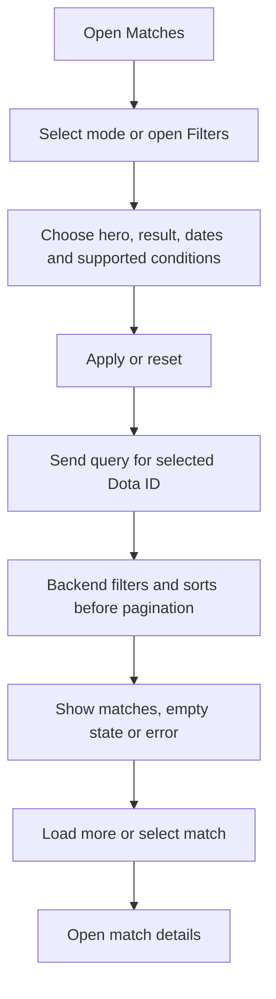

# Match history and filters

Open Matches, select a Dota account and apply mode or filter options before viewing match details.

API: `GET /api/v1/players/:id/matches`. Route: `/main/matches`.
Supported query fields include `hero_id`, `result`, `game_mode`, `lobby_type`, `from`, `to`, `limit`, and `offset`.
Send only supported conditions. Dates use Unix seconds: `from` is inclusive and `to` is exclusive.
History follows OpenDota's default significant-match scope. Records with hero_id=0 are excluded
before pagination without assigning a substitute hero. Large histories may time out; Retry is available.

Related files:

- [frontend/src/features/matches](../frontend/src/features/matches)
- [backend/src/modules/players](../backend/src/modules/players)
- [frontend/src/app/main/matches.tsx](../frontend/src/app/main/matches.tsx)
