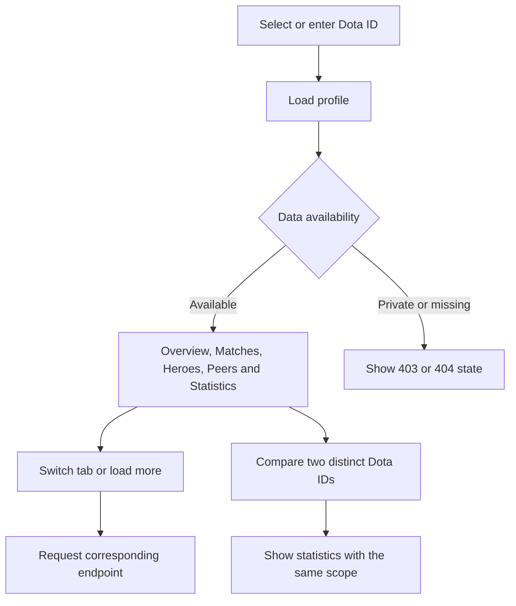

# Profiles, players and comparison

Guests and signed-in users can enter a Dota ID to view public data. Selecting an ID does not verify account ownership.

API: `/api/v1/players/:id`, with `/stats`, `/matches`, `/heroes`, `/peers`, and `/rank-history`;
comparison uses `/api/v1/players/compare`. Routes: `/main/profile`, `/players/detail`, `/players/compare`.
`PATCH /api/v1/auth/profile` saves the signed-in user's Dota ID preference.
Peers count games played on the same team. Rank history does not convert medals into MMR;
unavailable history returns 501. Users selecting the same Dota ID retain separate private data.

Related files:

- [frontend/src/features/players](../frontend/src/features/players)
- [backend/src/modules/players](../backend/src/modules/players)
- [frontend/src/app/players](../frontend/src/app/players)
