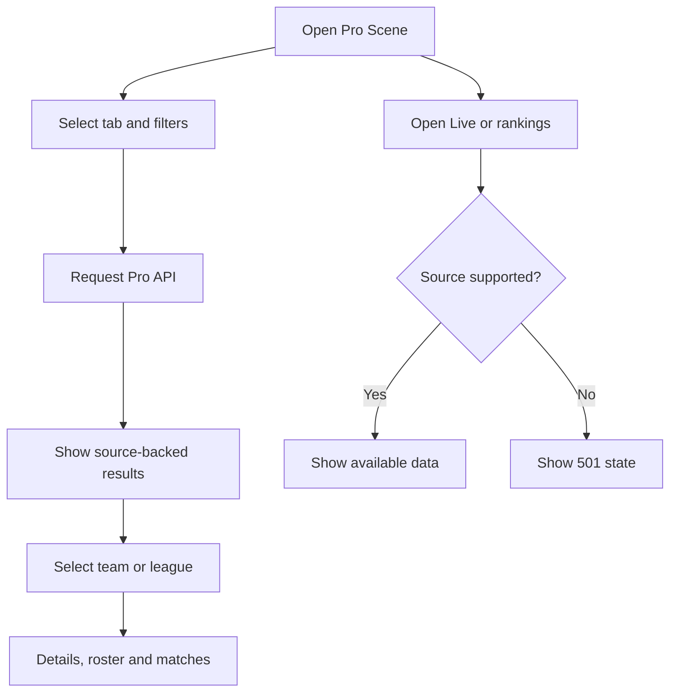

# Pro Scene and rankings

Browse Matches, Teams, Players and Tournaments, then open team or league details.

Routes: `/main/pro`, `/pro-scene/*`. API: `/api/v1/pro/*`.
Pro matches are a recent source snapshot, not a complete historical archive; total may be null.
Missing game/lobby modes are enriched from match details without invented defaults.
Fantasy roles are not treated as lanes, and individual game results are not series scores.
Missing dates or prize amounts remain null. Live returns 501; real Valve player leaderboards are unsupported.

Related files:

- [frontend/src/features/pro-scene](../frontend/src/features/pro-scene)
- [backend/src/modules/pro](../backend/src/modules/pro)
- [frontend/src/app/pro-scene](../frontend/src/app/pro-scene)
