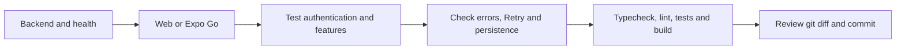

# Running and testing

Use Node.js >=24 and two PowerShell terminals. Create `.env` only when absent; preserve existing
configuration. API keys belong in the backend, never in `EXPO_PUBLIC_*` variables.

## Backend

```powershell
cd D:\Study\Project\OpenDotaClient\backend
npm.cmd ci
if (!(Test-Path .env)) { Copy-Item .env.example .env }
npm.cmd run db:migrate
npm.cmd run dev
```

Health: <http://localhost:3000/api/v1/health>. Enable `ENABLE_ACCOUNT_FEATURES=true`
for registration and sign-in. Configure allowed web Origins using `.env.example`.
Use a consistent localhost or LAN host for cookies. See [Authentication](auth-flow.md).

For compiled JavaScript, run `npm.cmd run build`, `npm.cmd run smoke:build`, then `npm.cmd start`.
The build copies SQL migrations and DTOs to dist; retain migration source files.

## Frontend web

```powershell
cd D:\Study\Project\OpenDotaClient\frontend
npm.cmd ci
if (!(Test-Path .env)) { Copy-Item .env.example .env }
npm.cmd run web
```

Frontend `.env`: `EXPO_PUBLIC_API_BASE_URL=http://localhost:3000/api/v1`.
Restart Metro after environment or routing changes. See [Routes and technology](technology-used.md).

## Physical Android device with Expo Go

Connect the phone and computer to the same Wi-Fi. Find the computer's IPv4 address with `ipconfig`;
it may change. Set `HOST=0.0.0.0` in the backend `.env` and use this frontend setting:

```dotenv
EXPO_PUBLIC_API_BASE_URL=http://<COMPUTER-LAN-IP>:3000/api/v1
```

Replace the placeholder with the actual IP and restart the backend. On the phone, first open
`http://<COMPUTER-LAN-IP>:3000/api/v1/health`. If blocked, check Windows Firewall permissions
for Node on Private networks. From the frontend directory, run:

```powershell
npm.cmd start -- --lan --clear
```

Scan the QR code using an SDK-compatible Expo Go version; otherwise use a compatible development build.
Form authentication runs inside the app without Steam callbacks. Android emulators use
`http://10.0.2.2:3000/api/v1`. Run one Metro process per checkout to avoid router type conflicts.

## Verification flow



## Automated checks

Backend:

```powershell
cd D:\Study\Project\OpenDotaClient\backend
npm.cmd run check
npm.cmd run build
npm.cmd run smoke:build
```

Frontend:

```powershell
cd D:\Study\Project\OpenDotaClient\frontend
npm.cmd run typecheck
npm.cmd run lint
npm.cmd run build:web
$env:E2E_WEB_PORT="18082"
npm.cmd run test:e2e
```

E2E uses an isolated host, SQLite database and upstream fixtures; it does not prove live source availability.
Run individual groups using `test:part1`, `test:part2` or `test:part3` in the corresponding directory.
Android export from the frontend: `node node_modules/expo/bin/cli export --platform android --output-dir dist-android`.
Export validates bundling; it neither creates an APK nor replaces physical-device testing.

Live GET smoke scripts run from the backend: `smoke:part1`, `smoke:part2`, `smoke:part3`.
They consume quota; team catalogs may require many requests. Do not submit parse POSTs merely to test connectivity.

## Demo checklist

- Register, sign in and sign out; refresh preserves sessions; switching accounts isolates private data.
- Check Home, match filters/details, Profile/Peers/Compare, Heroes/ranks/builds, Search and Pro.
- Favorites/settings/notifications persist after reload; users appear in the `users` table.
- Android: safe areas, keyboard, scrolling, Back, background/resume, network recovery and Retry.
- Keep `.env`, databases/backups, tokens and API keys out of commits.

Before the documentation rewrite, backend tests passed 101/101; frontend E2E had 25 passes and one optional
live skip; typecheck/lint passed. Web/Android export passed after routing changes but was not rerun after
the subsequent source cleanup. The user confirmed the manual checklist; physical iOS and live parse POST
remain unverified. These are historical results, not tests rerun during documentation translation.
