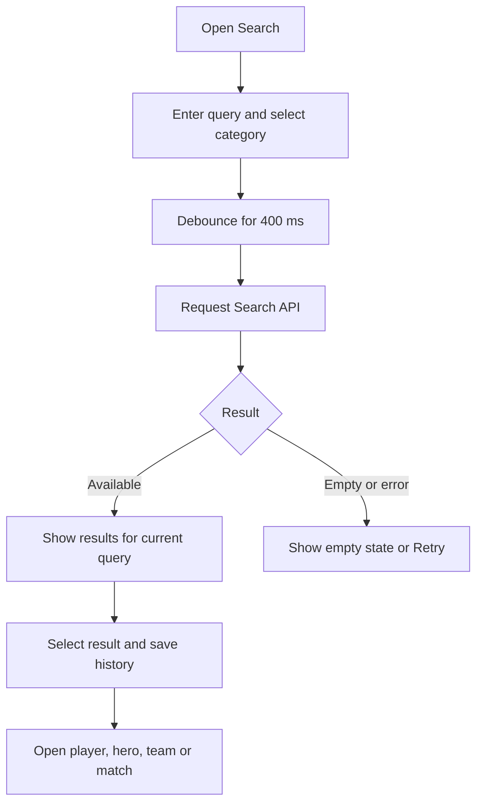

# Global search

Search players, heroes or teams, or enter a match ID. Search history is stored on the device.

Route: `/search`. API: `/api/v1/search`.
Changing query or category clears obsolete results. An entered match ID is an unverified suggestion;
the details screen validates it against real data. Keep IDs as strings to avoid numeric precision loss.
All-category search does not substitute sample results when a source fails.

Related files:

- [frontend/src/features/search](../frontend/src/features/search)
- [backend/src/modules/search](../backend/src/modules/search)
- [frontend/src/shared/navigation/routes.ts](../frontend/src/shared/navigation/routes.ts)
