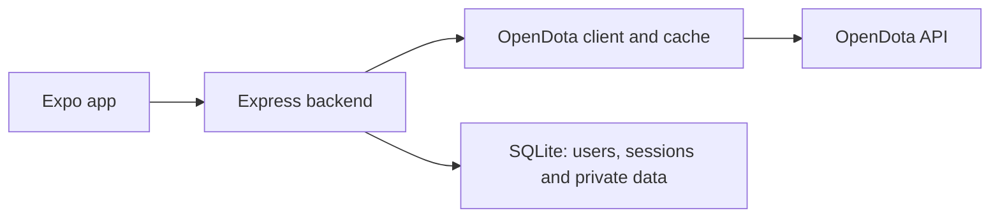

# Technology and structure

| Component | Technology / purpose |
| --- | --- |
| Frontend | Expo SDK 58, React Native 0.88, React 19.3, TypeScript 6 |
| Routing / data | Expo Router; TanStack Query cache and async state |
| Native storage | SecureStore for tokens; AsyncStorage for local preferences/history |
| Backend | Node.js >=24, Express 5, TypeScript 6, Zod |
| Database | Built-in Node SQLite, SQL migrations, WAL and foreign keys |
| Data source | Shared OpenDota client/cache/quota; backend-only API keys |
| Testing | Node test runner, Playwright, TypeScript, ESLint and Expo export |



Frontend `src/app` declares routes/layouts; `src/features` contains business features;
`src/shared` contains shared API/navigation/UI; `src/core` provides screen structure and themes.
Backend `src/app.ts` composes routers and `src/server.ts` bootstraps the server. `src/core` handles
HTTP/config, `src/modules` implements features, and `src/database` manages stores and migrations.
Shared DTOs live in [shared/api-contract.ts](../shared/api-contract.ts), separately from raw upstream schemas.
Retain applied migrations. The default database, `backend/data/opendota.sqlite`, stays outside Git.

## Routing

Updated October 28, 2026. Routes use ordinary directories without parenthesized route groups.
Business components remain in `frontend/src/features`; `src/app` contains routes/layouts only.

```text
frontend/src/app/
  _layout.tsx             # Providers, root stack and navigation
  index.tsx               # Redirect / to /main
  main/
    _layout.tsx           # Navigator preserves five-tab state
    index.tsx             # Home
    matches.tsx
    heroes.tsx
    pro.tsx
    profile.tsx
  heroes/
    detail.tsx
    ranks.tsx
    build.tsx
  matches/
    detail.tsx
  players/
    detail.tsx
    compare.tsx
  pro-scene/
    live.tsx
    rankings.tsx
    team.tsx
    league.tsx
  account/
    settings.tsx
    favorites.tsx
    notifications.tsx
  search/
    index.tsx
```

Ordinary directories become part of Expo Router URLs:

| Screen | URL |
| --- | --- |
| Home | `/main` |
| Matches / Heroes / Pro / Profile | `/main/matches`, `/main/heroes`, `/main/pro`, `/main/profile` |
| Hero details / rankings / builds | `/heroes/detail?id=17`, `/heroes/ranks`, `/heroes/build?heroId=17` |
| Match details | `/matches/detail?id=8312547001` |
| Player / Compare | `/players/detail?id=311360822`, `/players/compare` |
| Pro details | `/pro-scene/live`, `/pro-scene/rankings`, `/pro-scene/team?id=1`, `/pro-scene/league?id=1` |
| Account | `/account/settings`, `/account/favorites`, `/account/notifications` |
| Search | `/search` |

Previous flat URLs such as `/profile`, `/hero`, `/match` and `/settings` have been replaced.
Only `/` redirects to Home. Backend `/api/v1/...` paths and query ID values remain unchanged.
Keep IDs as strings to preserve precision for large match IDs.

`frontend/src/shared/navigation/routes.ts` defines URLs and the five tabs. Screens use
`go("hero", { id })`, `go("profile")`, etc. through `navigation.ts` instead of constructing URLs.
The root layout uses the same configuration to highlight the active tab. Details belong to the root stack;
the five main screens use the nested `main` navigator to preserve tab state.

After routing changes, restart Expo with `npm start -- --lan --clear` and reload Expo Go.
See [Authentication](auth-flow.md). E2E covers root redirects, tabs, search, details and account flows.

Reference: [Expo Router notation](https://docs.expo.dev/router/basics/notation/).
